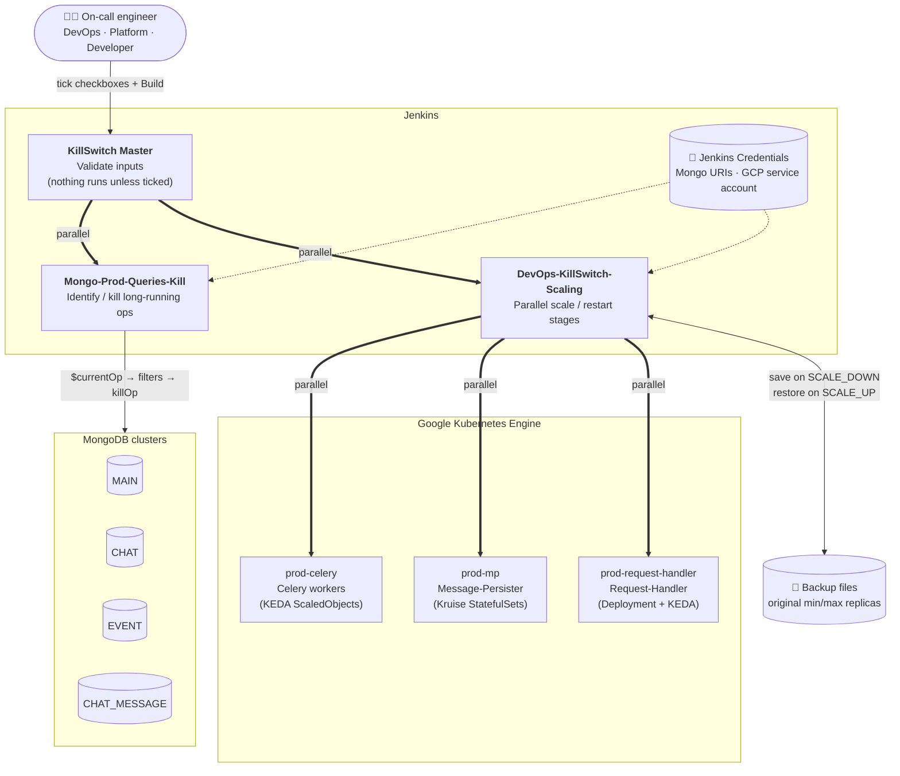
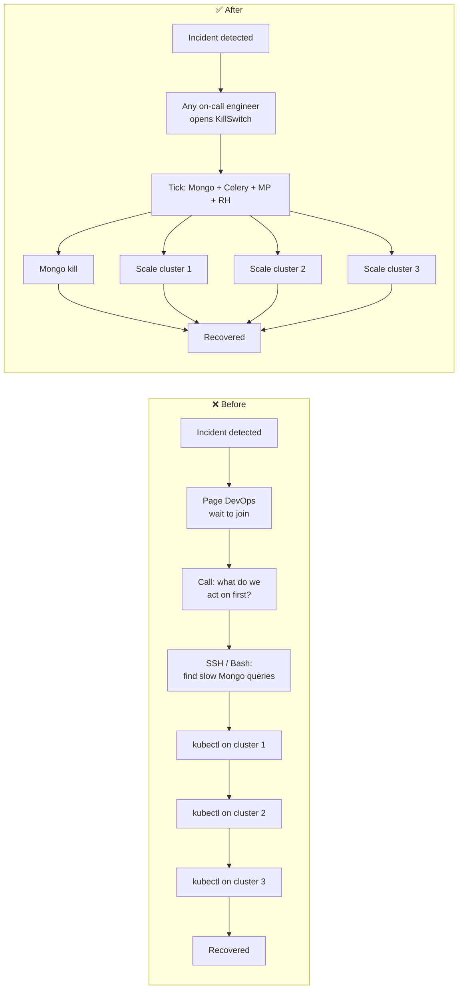
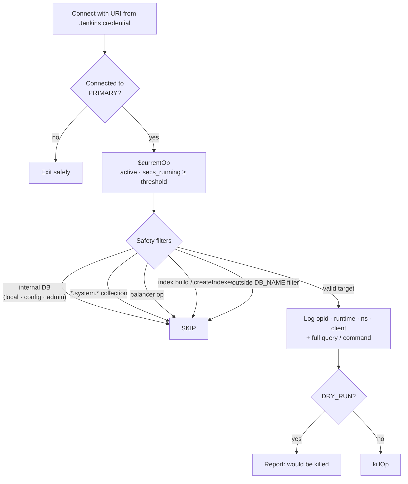
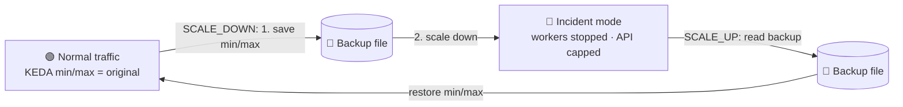

# ⚡ Incident KillSwitch — Self-Service Incident Response for MongoDB + Kubernetes

> One Jenkins form that lets **any on-call engineer** — DevOps, Platform or Developer — **identify / kill runaway MongoDB queries** and **scale down, scale up or restart production workloads across multiple GKE clusters, in parallel**, during a high-traffic incident.


---

## 🎯 At a glance

| | |
|---|---|
| **🔥 Toil I killed** | During high load / downtime, every mitigation step (kill slow Mongo queries, scale down consumers, restart the API tier) was run **by hand from Bash by the DevOps team only**, with time lost on calls deciding *which component to act on first* and *who runs what*. |
| **🛠️ What I built** | A **parallel execution framework** in Jenkins: a master "KillSwitch" job that fans out to (1) a **Mongo long-running-query identify / kill** job with built-in safety filters and (2) a **Kubernetes scaling** job that scales or restarts Celery, Message-Persister and Request-Handler across **3 GKE clusters at once**, with automatic backup + restore of autoscaling limits. |
| **💰 What it saved** | • **~70+ manual commands across 3 clusters → 1 form with checkboxes**<br>• Mitigation **no longer blocked on a DevOps engineer** — Platform and Dev teams self-serve<br>• Mongo kills and K8s scaling run **simultaneously instead of one after another**<br>• **Reduced MTTR**: `[before] → [after]` *(fill in with your measured numbers)* |
| **🔗 Code** | `[your GitHub link]` |

---

## 📌 Problem statement

During high traffic or a partial outage, recovering the platform meant running a sequence of Bash commands against MongoDB and several Kubernetes clusters. Three things made this slow:

1. **Dependency on one team.** Only DevOps had the access and the know-how, so every incident waited for a DevOps engineer to be paged, join, and get context.
2. **Communication toil.** Precious minutes went into deciding *what to act on first* — kill queries? stop the workers? restart the API? — and coordinating who runs which command.
3. **Sequential, error-prone execution.** Dozens of commands, run one by one, across different clusters and namespaces, under pressure. Restoring the original autoscaling limits afterwards relied on someone remembering them.

## ✅ Solution

Together with the team I **defined an incident strategy** and encoded it as a **parallel execution framework**:

- **One master job** with checkboxes — tick what you want, everything selected runs **in parallel**.
- **Mongo job** can run in **identify-only (dry run)** mode to *see* the long-running queries, or **kill** mode — and it **never touches internal DBs, system collections, balancer operations or index builds**.
- **Scaling job** acts on multiple clusters **simultaneously** using parallel stages, and **backs up autoscaler limits before scaling down** so scale-up restores the exact pre-incident shape.
- Access is granted through Jenkins RBAC, so **Platform and Developer teams can run it** without production shell access.

---

## 🏗️ Architecture



### Before vs after



---

## 🧩 Components

### 1. KillSwitch Master — [`jenkins/Jenkinsfile.master`](jenkins/Jenkinsfile.master)

The single entry point. It validates the request and triggers the downstream jobs **in parallel**, waiting on both and propagating failures.

| Parameter | Purpose |
|---|---|
| `RUN_MONGO_QUERY_KILL` | Run the Mongo job |
| `CORE_DATABASE_NAME` | `MAIN` / `CHAT` / `EVENT` / `CHAT_MESSAGE` |
| `SECONDS` | Threshold: target ops running longer than this |
| `DRY_RUN` | `true` = identify only, `false` = kill (defaults to `true`) |
| `DB_NAME` | Optional: restrict to one database |
| `GCP_CELERY` / `GCP_MP` / `GCP_SCALING_RH` / `GCP_ROLLOUT_RH` | Which workloads to act on |
| `SCALE_ACTION` | `SCALE_DOWN` or `SCALE_UP` |

Guardrails: refuses to run if nothing is ticked, accepts only a positive integer for `SECONDS` and a plain name for `DB_NAME` (the job is self-service, so free-text inputs are validated before they reach a shell).

### 2. Mongo long-running query identify / kill — [`jenkins/Jenkinsfile.mongo-query-kill`](jenkins/Jenkinsfile.mongo-query-kill) + [`scripts/mongo/kill_long_running_ops.py`](scripts/mongo/kill_long_running_ops.py)



- **Identify mode** prints every offending query in full — useful on its own to find the bad query or missing index.
- Each cluster maps to its own Jenkins **Secret text** credential; the URI is passed to the script via an environment variable, never as a CLI argument, so it doesn't appear in the process list.

### 3. Kubernetes scaling — [`jenkins/Jenkinsfile.k8s-scaling`](jenkins/Jenkinsfile.k8s-scaling)

All stages live in one `parallel` block, so every selected workload on every cluster is handled at the same time. Each stage runs in its own throwaway container and authenticates for itself.

| Workload | Cluster | SCALE_DOWN | SCALE_UP |
|---|---|---|---|
| **Celery workers** (16 allowlisted scalers) | `prod-celery` | Back up each KEDA ScaledObject's min/max → delete ScaledObjects → scale Deployments to 0 → force-remove stuck `Terminating` pods | Re-create each ScaledObject from a template using the backed-up min/max |
| **Message-Persister** | `prod-mp` | Scale Kruise StatefulSets to 0 | Scale back to the configured replica count |
| **Request-Handler** | `prod-request-handler` | Back up KEDA min/max → patch to incident limits → scale Deployment | Restore KEDA min/max from backup |
| **Request-Handler restart** | `prod-request-handler` | `kubectl rollout restart` (independent of scale action) | — |



Safety built into the scaling job:

- **Allowlist** — only named Celery scalers are touched, never "everything in the namespace".
- **Backup before change** — original autoscaling limits are saved before any scale-down.
- **Idempotent backups** — running SCALE_DOWN twice will **not** overwrite the good backup with the already-scaled-down values.
- **Fail fast** — scale-up stops if the backup or template is missing instead of guessing.

---

## 📂 Repository structure

```
.
├── README.md
├── jenkins/
│   ├── Jenkinsfile.master              # KillSwitch orchestrator (parallel fan-out)
│   ├── Jenkinsfile.mongo-query-kill    # Downstream: Mongo identify / kill
│   └── Jenkinsfile.k8s-scaling         # Downstream: GKE scale down / up / restart
├── scripts/
│   └── mongo/
│       ├── kill_long_running_ops.py    # Safe $currentOp + killOp script
│       └── requirements.txt
└── k8s/
    └── templates/
        ├── keda_celery.yaml            # Example KEDA ScaledObject template
        ├── celery_keda_config.csv      # Example per-queue scaling config
        └── README.md
```

## ⚙️ Setup

1. **Jenkins jobs** — create three Pipeline-from-SCM jobs pointing at this repo:

   | Job name | Script path |
   |---|---|
   | `KillSwitch-Master` | `jenkins/Jenkinsfile.master` |
   | `Mongo-Prod-Queries-Kill` | `jenkins/Jenkinsfile.mongo-query-kill` |
   | `DevOps-KillSwitch-Scaling` | `jenkins/Jenkinsfile.k8s-scaling` |

2. **Credentials** (Manage Jenkins → Credentials):
   - Secret text: `MongoMainDB`, `MongoChatDB`, `MongoEventDB`, `MongoChatMessageDB` — one connection string each.
   - Secret file: `GCP-PROD-DEPLOYMENT` — GCP service-account key with access to the three GKE clusters.
3. **Build agent** labelled `gcp-build` with Docker, and a build image containing `gcloud` + `kubectl`.
4. Copy `k8s/templates/keda_celery.yaml` and `celery_keda_config.csv` to `SCALING_JOB_DIR` on the agent.
5. **Access control** — grant *Build* on `KillSwitch-Master` to the Platform and Developer groups (e.g. via Role-Based Authorization Strategy).

### Run the Mongo script locally

```bash
cd scripts/mongo
python3 -m venv .venv && . .venv/bin/activate
pip install -r requirements.txt

export MONGO_URI='mongodb+srv://<user>:<password>@<host>/<db>?retryWrites=true'
python3 kill_long_running_ops.py --seconds 30 --dry-run            # identify only
python3 kill_long_running_ops.py --seconds 30 --db orders          # kill, one DB only
```

## 🚨 Typical incident playbooks

| Situation | Tick |
|---|---|
| DB CPU pegged, unsure why | `RUN_MONGO_QUERY_KILL` + `DRY_RUN=true` → read the offending queries |
| DB overloaded by runaway queries | `RUN_MONGO_QUERY_KILL` + `DRY_RUN=false` |
| Queue backlog is hammering the DB | `RUN_MONGO_QUERY_KILL` + `GCP_CELERY` + `SCALE_DOWN` — both in parallel |
| Full shed-load during an outage | Mongo kill + `GCP_CELERY` + `GCP_MP` + `GCP_SCALING_RH` + `SCALE_DOWN` |
| Recovery | `GCP_CELERY` + `GCP_MP` + `GCP_SCALING_RH` + `SCALE_UP` |
| API pods unhealthy / stuck | `GCP_ROLLOUT_RH` |

## 🛣️ Next steps

- Post the run summary (who, what, killed op count) to the incident Slack channel.
- Store backups in a ConfigMap or GCS bucket instead of a host directory.
- Require `DRY_RUN=true` first, then an `input` approval step before kill mode.

---


Average Time For KillSwitch Scaling 17s


Average Time For MongoQuery Killing 3s


Average Time for Master Job 19s


> **Note:** This is a sanitized version of an internal tool. Company/product names, cluster names, project IDs and credentials have been replaced with generic placeholders.
